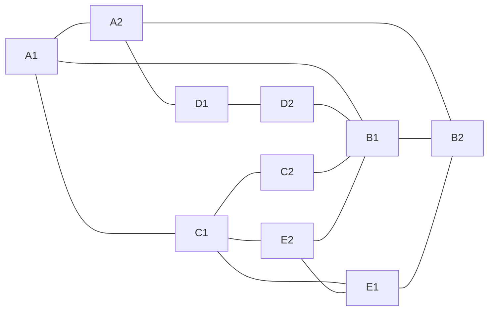

# WAN CI/CD Automation: Topology

10 WAN nodes (all IOSv), 15 links.
Nodes: A1, A2, B1, B2, C1, C2, D1, D2, E1, E2.

## Addressing plan

| Purpose | Range |
|---|---|
| Management (OOB, Gi0/0 on every node) | 10.255.0.0/24, host (br-mgmt) = 10.255.0.1 |
| Point-to-point links | 10.0.0.0/24, one /30 per link |
| Loopbacks | 10.1.1.0/24, one /32 per node |

## Nodes

| Node | Mgmt IP (Gi0/0) | Loopback0 |
|---|---|---|
| WAN-A1 | 10.255.0.11 | 10.1.1.1/32 |
| WAN-A2 | 10.255.0.12 | 10.1.1.2/32 |
| WAN-B1 | 10.255.0.13 | 10.1.1.3/32 |
| WAN-B2 | 10.255.0.14 | 10.1.1.4/32 |
| WAN-C1 | 10.255.0.15 | 10.1.1.5/32 |
| WAN-C2 | 10.255.0.16 | 10.1.1.6/32 |
| WAN-D1 | 10.255.0.17 | 10.1.1.7/32 |
| WAN-D2 | 10.255.0.18 | 10.1.1.8/32 |
| WAN-E1 | 10.255.0.19 | 10.1.1.9/32 |
| WAN-E2 | 10.255.0.20 | 10.1.1.10/32 |

## Link table

Fill the interface columns from GNS3 (View > Show/Hide interface labels). Data interfaces start at Gi0/1, since Gi0/0 is management. IP 1 and IP 2 are the last octet inside the link's /30.

| # | Endpoint 1 | Intf 1 | Endpoint 2 | Intf 2 | Subnet | IP 1 | IP 2 |
|---|---|---|---|---|---|---|---|
| 1 | WAN-A1 | Gi0/? | WAN-A2 | Gi0/? | 10.0.0.0/30 | .1 | .2 |
| 2 | WAN-A1 | Gi0/? | WAN-B1 | Gi0/? | 10.0.0.4/30 | .5 | .6 |
| 3 | WAN-A1 | Gi0/? | WAN-C1 | Gi0/? | 10.0.0.8/30 | .9 | .10 |
| 4 | WAN-A2 | Gi0/? | WAN-B2 | Gi0/? | 10.0.0.12/30 | .13 | .14 |
| 5 | WAN-B1 | Gi0/? | WAN-B2 | Gi0/? | 10.0.0.16/30 | .17 | .18 |
| 6 | WAN-A2 | Gi0/? | WAN-D1 | Gi0/? | 10.0.0.20/30 | .21 | .22 |
| 7 | WAN-D1 | Gi0/? | WAN-D2 | Gi0/? | 10.0.0.24/30 | .25 | .26 |
| 8 | WAN-D2 | Gi0/? | WAN-B1 | Gi0/? | 10.0.0.28/30 | .29 | .30 |
| 9 | WAN-C1 | Gi0/? | WAN-C2 | Gi0/? | 10.0.0.32/30 | .33 | .34 |
| 10 | WAN-C2 | Gi0/? | WAN-B1 | Gi0/? | 10.0.0.36/30 | .37 | .38 |
| 11 | WAN-C1 | Gi0/? | WAN-E1 | Gi0/? | 10.0.0.40/30 | .41 | .42 |
| 12 | WAN-E1 | Gi0/? | WAN-B2 | Gi0/? | 10.0.0.44/30 | .45 | .46 |
| 13 | WAN-C1 | Gi0/? | WAN-E2 | Gi0/? | 10.0.0.48/30 | .49 | .50 |
| 14 | WAN-E2 | Gi0/? | WAN-E1 | Gi0/? | 10.0.0.52/30 | .53 | .54 |
| 15 | WAN-E2 | Gi0/? | WAN-B1 | Gi0/? | 10.0.0.56/30 | .57 | .58 |

## Notes for a later containerlab move

- Keep interface names here as the logical IOS names. Containerlab uses its own names (for example eth1), so a mapping will be needed then.
- This file is the single source for node names, links and addresses. The Ansible inventory, NetBox data and any containerlab file should be generated from it, not typed again.
